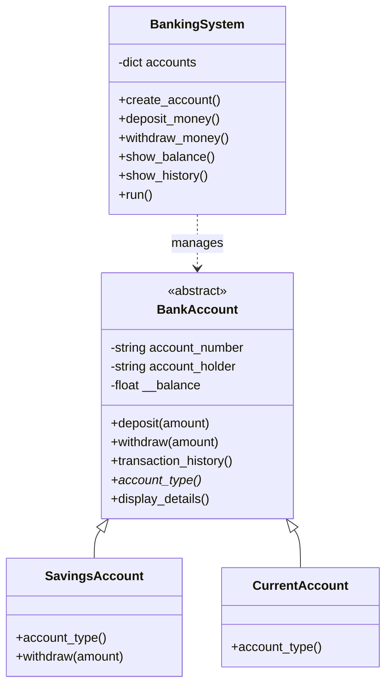

# Python Banking System

**Module 03 — Object-Oriented Python**

A menu-driven Python banking application demonstrating object-oriented programming concepts.

## Features
- Create Savings and Current accounts
- Deposit and withdraw money
- Check account details and balance
- View transaction history
- Validate input and handle invalid transactions

## OOP concepts demonstrated
- **Class and objects:** `BankAccount`, `SavingsAccount`, `CurrentAccount`, `BankingSystem`
- **Constructor:** `__init__()` initializes account information
- **Encapsulation:** account balance is stored in the private attribute `__balance`
- **Inheritance:** SavingsAccount and CurrentAccount inherit from BankAccount
- **Polymorphism:** each account type provides its own `account_type()` method; SavingsAccount also customizes withdrawal
- **Abstraction:** BankAccount is an abstract base class

## Class diagram



## Requirements
- Python 3.8 or newer
- No third-party packages required

## Run
```bash
python main.py
```

## Notes
This is an educational, in-memory demonstration. Accounts and transactions are not persisted after the program exits. Do not use real banking credentials or real money.
